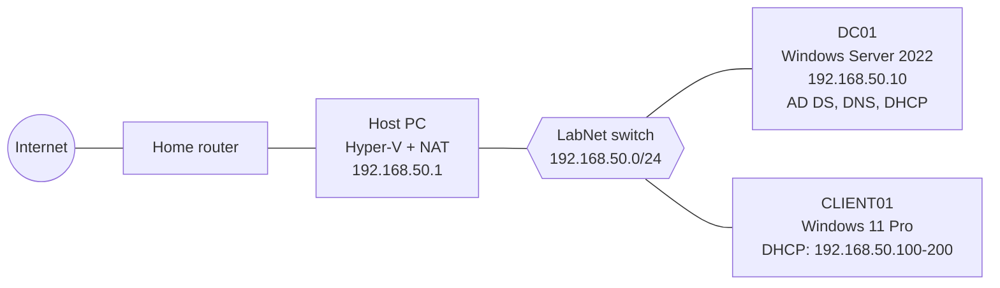

# Helpdesk-labra

Kotilabra, jolla harjoittelen IT-tuen ja yritysympäristön perustehtäviä: Active Directory, DNS, DHCP, käyttäjähallinta, Group Policy, tikettijärjestelmä ja vianmääritys.

> Tämä on oppimisprojekti. Ympäristö on eristetty kotiverkostani, eikä siinä ole oikeita käyttäjiä tai tietoja.

## Tavoite

- Oppia IT-ylläpidon ja käyttötuen perusteet käytännössä
- Dokumentoida tekemäni niin, että joku muu pystyy toistamaan sen
- Kerätä näyttöä osaamisesta työnhakua varten

## Ympäristö

| Osa        | Kuvaus                                            |
| ---------- | ------------------------------------------------- |
| Isäntäkone | PC, 16 GB RAM, Hyper-V                            |
| Palvelin   | Windows Server 2022 (DC01): AD DS, DNS, DHCP      |
| Asiakkaat  | Windows 11 -VM ja fyysinen läppäri (8 GB)         |
| Verkko     | Sisäinen Hyper-V-kytkin `LabNet`, 192.168.50.0/24 |
| Domain     | lab.local                                         |

<!-- Lisää tähän verkkokaavio, kun se on tehty: screenshots/network-diagram.png -->

## Edistyminen

- [x] Vaihe 1: Domain controller (AD, DNS, DHCP) → [docs/01-domain-controller.md](docs/01-domain-controller.md)
- [ ] Vaihe 2: Käyttäjät, ryhmät ja Group Policy
- [ ] Vaihe 3: Tiedostopalvelin ja oikeudet
- [ ] Vaihe 4: Tikettijärjestelmä (GLPI tai osTicket)
- [ ] Vaihe 5: Etätuki ja valvonta
- [ ] Vaihe 6: Microsoft 365 -kokeilutenantti ja Intune

## Repon rakenne

```
docs/              Vaihe vaiheelta -dokumentaatio
scripts/           Omat PowerShell-skriptit
troubleshooting/   Ratkaistut ongelmat: oire, syy, korjaus
screenshots/       Kuvakaappaukset
```

## Mitä olen oppinut

<!-- Kirjoita tähän omin sanoin 3-5 tärkeintä oppia. Päivitä projektin edetessä. -->

## Huomio

Repossa ei ole salasanoja, lisenssiavaimia eikä kotiverkon oikeita osoitteita.


