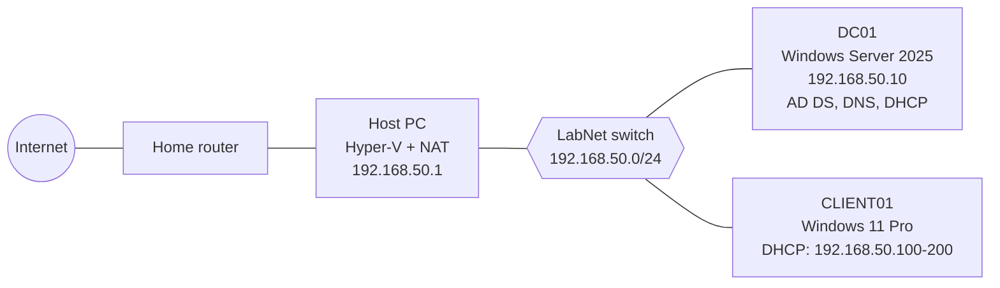

# Active Directory Homelab

A home lab where I practice IT support and system administration: Active Directory, DNS, DHCP, user management, Group Policy, ticketing and troubleshooting.

> This is a learning project. The environment contains no real users or data.

🇫🇮 [Suomeksi](README.fi.md)

## Goals

- Learn IT support and system administration skills through hands-on practice
- Document my progress so that anyone can replicate it

## Lab overview

- Windows Server 2025 domain controller (AD DS, DNS, DHCP)
- Windows 11 VM client joined to the domain
- Hyper-V on a single host, internal network with NAT (192.168.50.0/24)



## Progress

- [x] Step 1: Domain controller (AD, DNS, DHCP) → [docs/01-domain-controller.md](docs/01-domain-controller.md)
- [x] Step 2: Users, groups and Group Policy
- [x] Step 3: File server and permissions
- [x] Step 4: Ticketing system (GLPI or osTicket)
- [ ] Step 5: Remote support and monitoring
- [ ] Step 6: Microsoft 365 trial tenant and Intune

## Repo structure

```
docs/              Step-by-step documentation
screenshots/       Screenshots
```

## What I have learned

_To be filled in as the project progresses._

## Note

This repository contains no passwords, license keys or real home network addresses.
