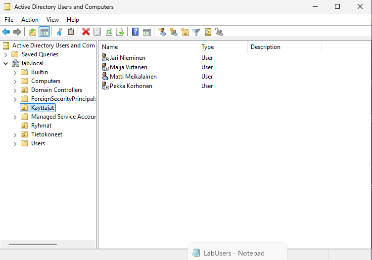
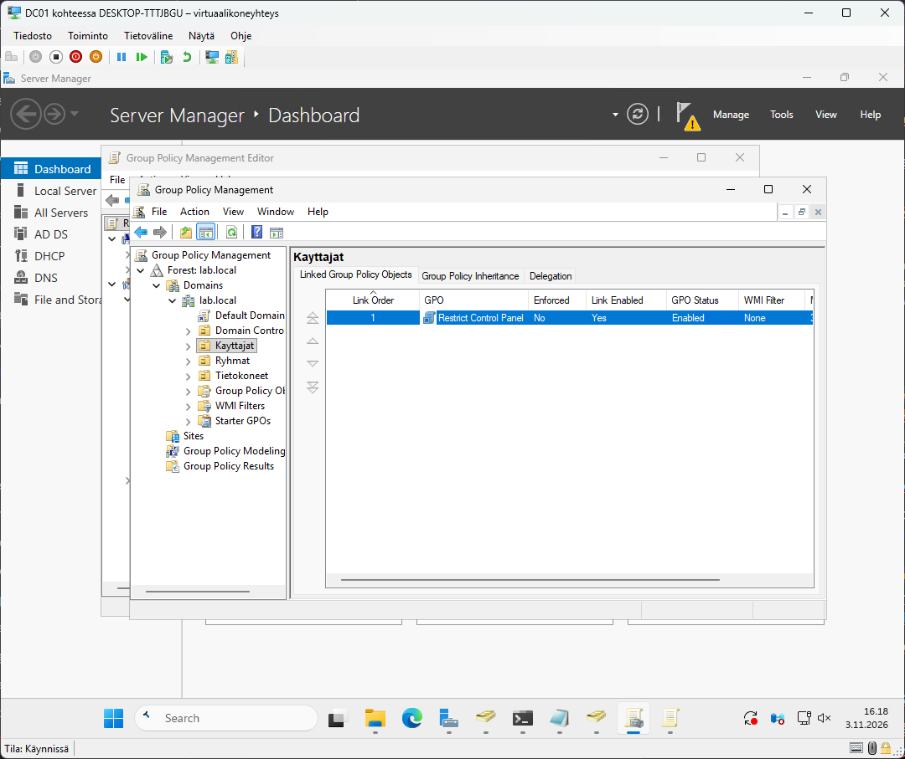
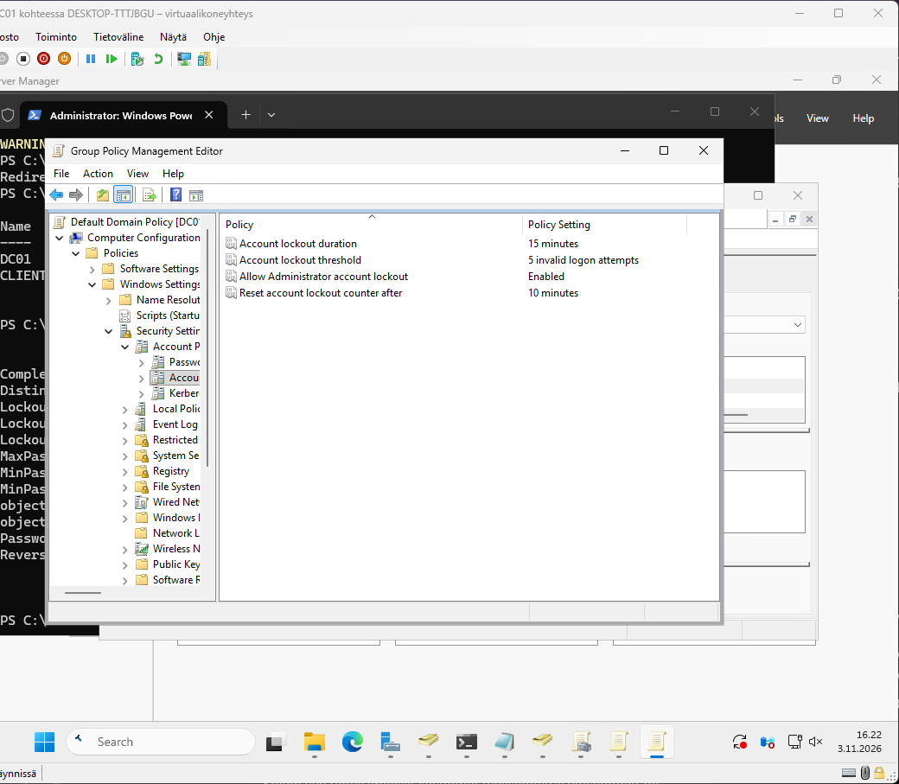
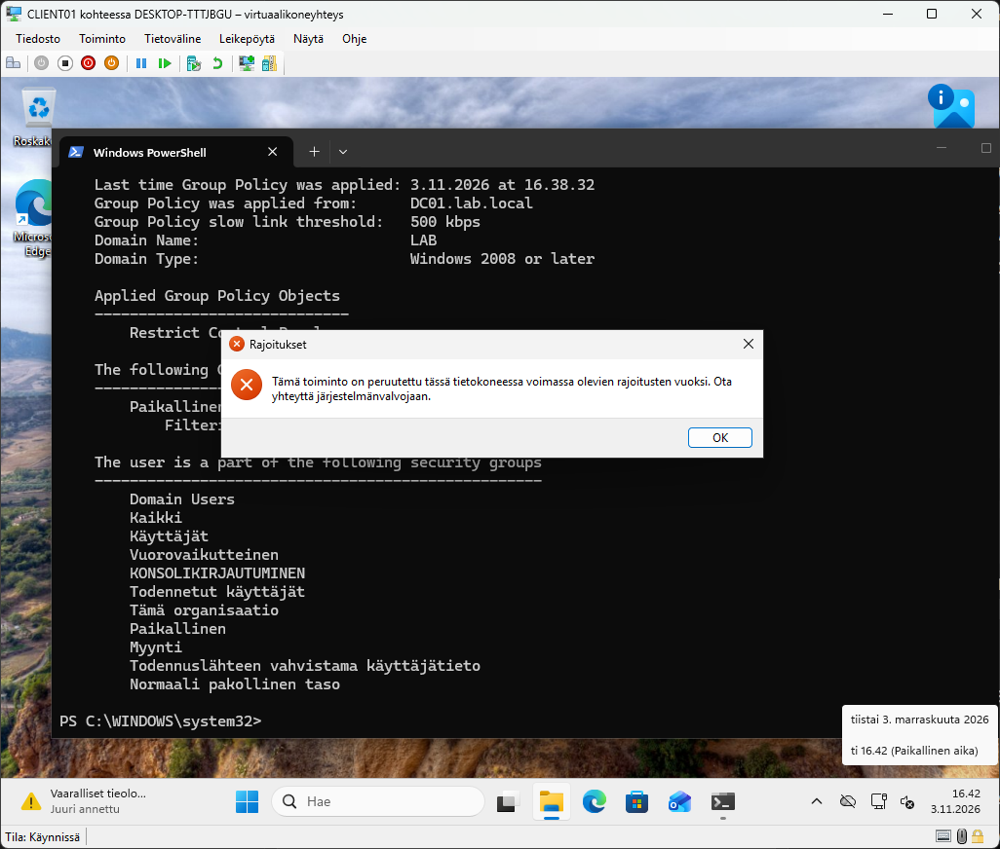
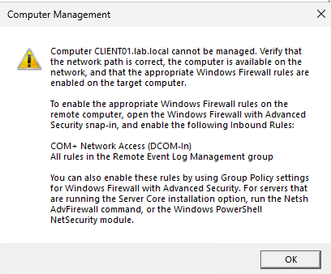

# Step 2: Users, groups and Group Policy

In this part I created new users, moved them to right OU and made some Group Policies.

## 1. Creating users from a CSV file

I created a CSV file `C:\Lab\users.csv` on DC01:

```csv
GivenName,Surname,Group
Maija,Virtanen,Talous
Pekka,Korhonen,Myynti
Juha,Nieminen,Talous
```

Then I wrote a script that reads the file and creates each user in the `Kayttajat` OU:

```powershell
param([string]$CsvPath = "C:\Lab\users.csv")

Import-Module ActiveDirectory
$base = "DC=lab,DC=local"
$password = Read-Host -AsSecureString "Initial password for all users"

foreach ($row in Import-Csv -Path $CsvPath) {
    $sam = ("{0}.{1}" -f $row.GivenName, $row.Surname).ToLower()

    if (Get-ADUser -Filter "SamAccountName -eq '$sam'") {
        Write-Warning "$sam already exists, skipping."
        continue
    }

    New-ADUser -Name "$($row.GivenName) $($row.Surname)" `
        -GivenName $row.GivenName -Surname $row.Surname `
        -SamAccountName $sam -UserPrincipalName "$sam@lab.local" `
        -Path "OU=Kayttajat,$base" -AccountPassword $password `
        -ChangePasswordAtLogon $true -Enabled $true

    Add-ADGroupMember -Identity $row.Group -Members $sam
    Write-Host "Created: $sam ($($row.Group))"
}
```

First we the csv file as a parameter. Then initialize some constants, and after that the script loops through all the rows in the cvs file. First it check if the user is already added, and if not, a new user will be added and put to the right group.

Verification:

```powershell
Get-ADUser -Filter * -SearchBase "OU=Kayttajat,DC=lab,DC=local" | Select-Object Name, SamAccountName, Enabled
Get-ADGroupMember -Identity "Myynti" | Select-Object Name
```



## 2. Moving CLIENT01 to its own OU

Next I moved the client pc to its own OU and made it so that all new computers will be added to this OU automatically.

## 3. First Group Policy

I created a GPO called `Restrict Control Panel` and linked it to the `Kayttajat` OU.



## 4. Password policy

Next I created some a new password policy, which required the user passwords to be at least 10 characters long.


Also changed account lockout policies so that the account locks out after 5 failed attempts.



## 5. Testing on the client

On CLIENT01, signed in as a domain user:

```powershell
gpupdate /force
gpresult /r
```

`Restrict Control Panel` appears under _Applied Group Policy Objects_, and opening Control Panel shows a "restricted" message. The domain Administrator is not in the `Kayttajat` OU, so the policy does not apply to that account.



## Problems I ran into

### Computer Management cannot manage CLIENT01

- **Symptom:** "Computer CLIENT01.lab.local cannot be managed" when connecting from DC01.
- **Cause:** Windows Firewall on the client blocks remote management by default (DCOM and Remote Event Log Management rules).
- **Fix:** Moved the user that was logged on to ClIENT01 to `Remote management users` which solved the issue.



->
