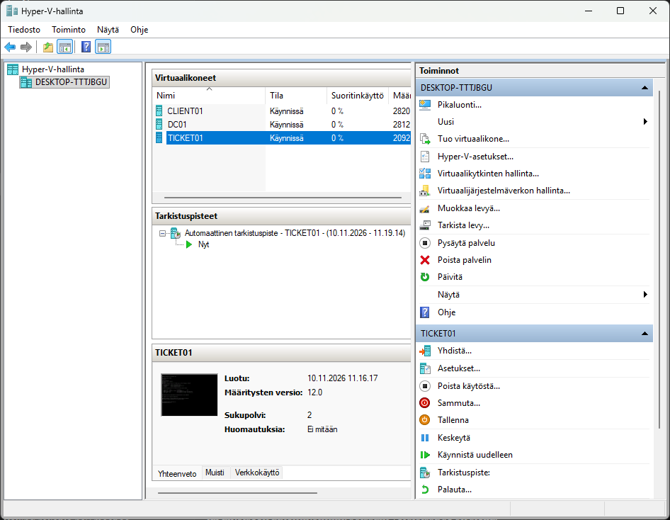

# Step 4: Ticketing system (GLPI)

In this step I created a ticketing system using GLPI

## Plan

| Item       | Value                                                    |
| ---------- | -------------------------------------------------------- |
| VM         | `TICKET01` (Hyper-V, Generation 2, 2 GB RAM, 20 GB disk) |
| OS         | Ubuntu Server 24.04 LTS                                  |
| IP address | `192.168.50.20` (static)                                 |
| Software   | Apache, PHP, MariaDB, GLPI                               |
| Login      | Active Directory accounts through LDAP                   |

## 1. Creating the virtual machine

First i created VM for the ticketing server.

```powershell
New-VM -Name "TICKET01" -Generation 2 -MemoryStartupBytes 2GB -NewVHDPath "E:\VMs\TICKET01\TICKET01.vhdx" -NewVHDSizeBytes 20GB -SwitchName "LabNet" -Path "E:\VMs"
Set-VMProcessor -VMName "TICKET01" -Count 2
Set-VMFirmware -VMName "TICKET01" -EnableSecureBoot On -SecureBootTemplate "MicrosoftUEFICertificateAuthority"
Add-VMDvdDrive -VMName "TICKET01" -Path "E:\ISO\<ubuntu-iso-file-name>.iso"
$dvd = Get-VMDvdDrive -VMName "TICKET01"
Set-VMFirmware -VMName "TICKET01" -FirstBootDevice $dvd
```



## 2. Installing Ubuntu Server

Next I installed Ubuntu server on the VM.

```bash
sudo apt update
sudo apt upgrade -y
sudo timedatectl set-timezone Europe/Helsinki
```

Then I set a static IP with netplan (`/etc/netplan/<file>.yaml`):

```yaml
network:
  version: 2
  ethernets:
    eth0: # use the real interface name from `ip a`
      dhcp4: false
      addresses: [192.168.50.20/24]
      routes:
        - to: default
          via: 192.168.50.1
      nameservers:
        addresses: [192.168.50.10]
        search: [lab.local]
```

Next I made sure the connection works

```bash
sudo netplan try
ip a
ping -c 3 8.8.8.8
ping -c 3 archive.ubuntu.com
```

On DC01, I added a DNS record so other machines can find the server by name:

```powershell
Add-DnsServerResourceRecordA -Name "ticket01" -ZoneName "lab.local" -IPv4Address 192.168.50.20
```


## 3. Installing Apache, PHP, MariaDB and GLPI

Next I installed the classic LAMP stack.

```bash
sudo apt install -y apache2 mariadb-server php libapache2-mod-php \
  php-apcu php-cli php-common php-curl php-gd php-ldap php-mysql \
  php-xml php-mbstring php-bcmath php-intl php-zip php-bz2
sudo mysql_secure_installation
```

Database and user for GLPI (`sudo mysql`):

```sql
CREATE DATABASE glpi CHARACTER SET utf8mb4 COLLATE utf8mb4_unicode_ci;
CREATE USER 'glpi'@'localhost' IDENTIFIED BY '<password>';
GRANT ALL PRIVILEGES ON glpi.* TO 'glpi'@'localhost';
GRANT SELECT ON mysql.time_zone_name TO 'glpi'@'localhost';
FLUSH PRIVILEGES;
EXIT;
```

```bash
sudo mysql_tzinfo_to_sql /usr/share/zoneinfo | sudo mysql mysql
```

Next I downloaded GLPI:

```bash
cd /tmp
wget <link-to-glpi-11.0.x.tgz>
sudo tar -xzf glpi-*.tgz -C /var/www/html/
sudo chown -R www-data:www-data /var/www/html/glpi
```

Apache site `/etc/apache2/sites-available/glpi.conf`:

```apache
<VirtualHost *:80>
    ServerName ticket01.lab.local
    DocumentRoot /var/www/html/glpi/public

    <Directory /var/www/html/glpi/public>
        Require all granted
        RewriteEngine On
        RewriteCond %{REQUEST_FILENAME} !-f
        RewriteRule ^(.*)$ index.php [QSA,L]
    </Directory>
</VirtualHost>
```

I disabled the default Apache site, enabled the rewrite module and enabled the GLPI site. Then I tested the configuration and reloaded Apache.

```bash
sudo a2enmod rewrite
sudo a2dissite 000-default
sudo a2ensite glpi.conf
sudo apache2ctl configtest
sudo systemctl reload apache2
```

PHP settings in `/etc/php/8.3/apache2/php.ini` :

```ini
upload_max_filesize = 20M
post_max_size = 20M
max_execution_time = 60
max_input_vars = 5000
memory_limit = 256M
session.cookie_httponly = On
date.timezone = Europe/Helsinki
```

```bash
sudo systemctl restart apache2
```

## 4. GLPI web installer

I opened `http://ticket01.lab.local` on CLIENT01 and followed the installer. All requirements were green.

After the installation I changed the default passwords of the built-in accounts.


## 5. Active Directory login (LDAP)

I created a service account `svc-glpi` in an OU called `Palvelutilit` and added the LDAP directory in GLPI

| Setting               | Value                          |
| --------------------- | ------------------------------ |
| Server                | `dc01.lab.local`, port `389`   |
| BaseDN                | `OU=Kayttajat,DC=lab,DC=local` |
| RootDN                | `svc-glpi@lab.local`           |
| Login field           | `samaccountname`               |
| Synchronization field | `objectguid`                   |


I tested the connection from TICKET01 as well, without GLPI:

```bash
sudo apt install -y ldap-utils
ldapsearch -x -H ldap://192.168.50.10 -D "svc-glpi@lab.local" -W -b "OU=Kayttajat,DC=lab,DC=local" "(objectClass=user)" sAMAccountName
```

## 6. Categories and tickets

I created ITIL categories in _Setup → Dropdowns → Assistance → ITIL categories_ and tested the ticket flow:

1. Matti created a ticket (Incident, category _Tiedostopalvelin_).
2. I assigned it to myself, added a follow-up and wrote a solution.
3. The ticket moved New → Processing → Solved.


| Test                                          | Expected                                   | Result          |
| --------------------------------------------- | ------------------------------------------ | --------------- |
| `http://ticket01.lab.local` opens on CLIENT01 | Login page                                 | <!-- yes/no --> |
| Matti signs in with his AD password           | Works                                      | <!-- yes/no --> |
| Matti creates a ticket                        | Appears in the admin list                  | <!-- yes/no --> |
| Admin solves the ticket                       | Status _Solved_, solution visible to Matti | <!-- yes/no --> |

## Problems I ran into

### Ubuntu installer could not reach the package mirror

- **Symptom:** "Temporary failure resolving archive.ubuntu.com" in the mirror configuration step.
- **Cause:** DC01 (the DNS server) was powered off, and NAT had not been created
- **Fix:** started DC01

### Installer did not keep the static gateway and DNS

- **Symptom:** Gateway and name server fields were empty again when I reopened the form.
- **Cause:** Did not find out the cause
- **Fix:** Enabed automatic DHCP

### Apache configtest: Invalid command 'RewriteEngine'

- **Symptom:** `apache2ctl configtest` failed.
- **Cause:** rewrite module was not enabled
- **Fix:** There was a typo in the config

### LDAP test: "Strong(er) authentication required (8)"

- **Symptom:** the LDAP test in GLPI and `ldapsearch` both failed with error 8.
- **Cause:** Windows Server 2025 enforces LDAP signing; GLPI uses a simple bind on port 389
- **Fix:** Changed GPO (Default Domain Controllers Policy) settings on DC01
